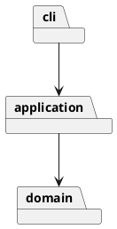

# 架构与开发记录

状态：第二步完成，自动化验证通过。以下未完成项将在开发过程中据实补充。

## 架构方案

### 模块划分

- `domain/`：画布、图形封装、容器树与唯一 id 约束。
- `application/`：编辑会话、Command 接口及命令、图形工厂。
- `cli/`：文本解析、命令分发和终端输入输出。

第一步领域对象暂时提供文本摘要供查询显示，未来若增加 GUI，应把展示格式移到独立展示适配器。

### 设计模式的选择

- Command：EditCommand 在隔离副本上执行编辑，成功后记录前后文档快照；Editor 管理 undo/redo 栈。CreateCommand 和 EditingCommands 构造每次独立的编辑命令。
- Composite：Shape 定义 move/scale/set/clone，五种叶子图形封装自身几何字段，Group 递归委托子节点。
- 名字分派仅允许在命令分发和图形工厂两处，按要求标注为待重构点。

### 依赖方向规则

`cli → application → domain`；domain 不引用 application/cli 或文件系统。入口负责组装对象。CLI 不直接修改领域对象。

### 变化点假设

待分析：图形类型扩展、输入通道、持久化、命令集合；按需要决定扩展点，记录取舍。

## 过程记录

### 2026-10-30：要求阅读与仓库初始化

- 阅读原始附件，确认 Phase 1 仅内置 rect/circle/ellipse/line/text/g；box 与插件化属于后续阶段。
- 确认要求 TypeScript、封装与多态、一类一文件，禁止公共数据袋和散落的类型分派。
- 确认每条编辑命令为一个 undo 单元；失败不得改变任何状态。
- 确认 init/read/save 及 canvas 修改尺寸后禁止 undo/redo，直到下一次编辑命令解禁。
- 保留原始要求，先建立文档框架与阶段计划，尚未实现应用或执行功能测试。

### 待澄清的语义

- SVG 背景示例含 transform，但命令细则以改写几何属性描述变换；外部 transform 的读入范围需明确。
- group 跨不同父容器时的插入位置与相对顺序需形成明确决策。
- front/back 与“最前/最后”的节点顺序、绘制层级需明确对应关系。

## 一致性自查

- 模块划分：实际为 cli/application/domain，符合方案；test 单独存放验证代码。
- 依赖方向：已抽查 imports，domain 无上层依赖及文件系统 IO；application 依赖 domain，cli 依赖 application。

## 质量保证手段

计划覆盖六种图形、嵌套容器、属性白名单、唯一 id、失败原子性、撤销重做分支、SVG 读写往返与缺 id 补全，并回放附件典型会话。

实际结果见以下阶段记录。

### 2026-10-30：第一步实现

- 实现六种图形的封装类与 Group 组合树，绘图文档维护 id 索引。
- 实现 Command 执行接口及创建、新建和查询命令；撤销协议将在下一阶段加入。
- 两处名字分派分别为 CommandDispatcher 和 ShapeFactory，插件阶段待重构为注册机制。
- 运行 `npm run check` 通过；回放嵌套创建、查询与重复 id 场景通过。完整功能尚未实现，也未进行全量验收。
- 原子性策略：创建前校验参数、id 和父容器，校验通过后才挂入树。
- 实际目录符合当前三层方案；抽样检查 domain imports，未引用上层或 IO。

### 2026-10-30：第二步实现与验证

- 用户明确由开发端完成所有非 GUI 测试，因此加入 Node 内置测试运行器，无需用户逐条测试 CLI。
- 编辑命令在文档克隆上运行，成功才整体替换并进入历史；失败丢弃克隆。选择快照而非逐字段逆操作，减少组合编辑遗漏恢复状态的风险，代价是每次编辑 O(n) 的复制和内存成本。
- 修正第一步样式字段的设计：公共样式由 Shape 封装，几何字段仍由各图形类管理，避免修改 fill 后旧值残留或复制丢失。
- 跨父容器分组按原文档深度优先顺序排列，组放在首个成员原父级及位置；front/back 分别对应 SVG 最后/第一个兄弟节点。
- 明确样式继承：set 容器 fill/stroke 不覆盖子节点显式值；scale 只缩放附件规定的几何属性，不缩放 stroke-width。
- undo/redo 反馈先采用整体摘要，未加入差异属性展示。
- `npm run check` 和 `npm test` 通过，11 组测试覆盖六类图形、几何白名单、样式、递归变换、历史分支、分组、层级迁移、顺序、删除恢复、IO 屏障及 CLI 子进程回放。
- 失败原子性验证包含：容器变换中途数值溢出、循环归属、重复成员/ID、非法属性/尺寸/参数、无效父级和解析错误；均保持原画布与 redo 历史。
- SVG read/save 尚未实现，完整作业一致性验收及 final 标签仍待后续阶段。
