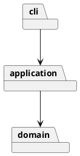

# 架构与开发记录

状态：第一步完成，等待人工验收。以下未完成项将在开发过程中据实补充。

## 架构方案

### 模块划分

- `domain/`：画布、图形封装、容器树与唯一 id 约束。
- `application/`：编辑会话、Command 接口及命令、图形工厂。
- `cli/`：文本解析、命令分发和终端输入输出。

第一步领域对象暂时提供文本摘要供查询显示，未来若增加 GUI，应把展示格式移到独立展示适配器。

### 设计模式的选择

- Command：作业强制要求，用于封装编辑操作及撤销、重做；具体设计待完成。
- Composite：容器与叶子图形统一操作；具体类层次待完成。
- 名字分派仅允许在命令分发和图形工厂两处，按要求标注为待重构点。

### 依赖方向规则

`cli → application → domain`；domain 不引用 application/cli 或文件系统。入口负责组装对象。CLI 不直接修改领域对象。

### 变化点假设

待分析：图形类型扩展、输入通道、持久化、命令集合；按需要决定扩展点，记录取舍。

## 过程记录

### 2026-10-30：要求阅读与仓库初始化

- 阅读原始附件，确认 Phase 1 仅内置 rect/circle/ellipse/line/text/g；box 与插件化属于后续阶段。
- 确认要求 TypeScript、封装与多态、一类一文件，禁止公共数据袋和散落的类型分派。
- 确认每条编辑命令为一个 undo 单元；失败不得改变任何状态。
- 确认 init/read/save 及 canvas 修改尺寸后禁止 undo/redo，直到下一次编辑命令解禁。
- 保留原始要求，先建立文档框架与阶段计划，尚未实现应用或执行功能测试。

### 待澄清的语义

- SVG 背景示例含 transform，但命令细则以改写几何属性描述变换；外部 transform 的读入范围需明确。
- group 跨不同父容器时的插入位置与相对顺序需形成明确决策。
- front/back 与“最前/最后”的节点顺序、绘制层级需明确对应关系。

## 一致性自查

- 模块划分：尚未实现，待核对。
- 依赖方向：尚未实现，待核对。

## 质量保证手段

计划覆盖六种图形、嵌套容器、属性白名单、唯一 id、失败原子性、撤销重做分支、SVG 读写往返与缺 id 补全，并回放附件典型会话。

实际验证结果将在执行后补充，当前未执行功能测试。

### 2026-10-30：第一步实现

- 实现六种图形的封装类与 Group 组合树，绘图文档维护 id 索引。
- 实现 Command 执行接口及创建、新建和查询命令；撤销协议将在下一阶段加入。
- 两处名字分派分别为 CommandDispatcher 和 ShapeFactory，插件阶段待重构为注册机制。
- 运行 `npm run check` 通过；回放嵌套创建、查询与重复 id 场景通过。完整功能尚未实现，也未进行全量验收。
- 原子性策略：创建前校验参数、id 和父容器，校验通过后才挂入树。
- 实际目录符合当前三层方案；抽样检查 domain imports，未引用上层或 IO。
