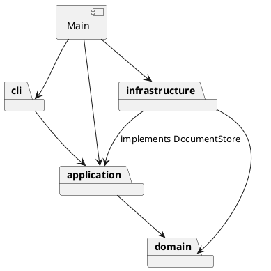

# 架构与开发记录

状态：Phase 1 交付验收版，自动化验证通过；浏览器渲染由使用者目视确认。

## 架构方案

### 模块划分

- `domain/`：画布、图形封装、容器树与唯一 id 约束。
- `application/`：编辑会话、Command 接口及命令、图形工厂。
- `cli/`：文本解析和命令分发。
- `infrastructure/`：SVG XML 编解码、变换归一化及本地文件系统适配。
- `Main.ts`：组合根，连接终端输入输出、会话、分发器与存储实现。

第一步领域对象暂时提供文本摘要供查询显示，未来若增加 GUI，应把展示格式移到独立展示适配器。

### 设计模式的选择

- Command：EditCommand 在隔离副本上执行编辑，成功后记录前后文档快照；Editor 管理 undo/redo 栈。CreateCommand 和 EditingCommands 构造每次独立的编辑命令。
- Composite：Shape 定义 move/scale/set/clone，五种叶子图形封装自身几何字段，Group 递归委托子节点。
- 名字分派仅允许在命令分发和图形工厂两处，按要求标注为待重构点。

### 依赖方向规则

- `cli → application → domain`：文本命令通过用例修改模型。
- `infrastructure → application/domain`：实现 application 的 DocumentStore 接口，构造/序列化领域对象。
- domain 不依赖上层、Node IO 或 XML 库；application 不引用 infrastructure，文件命令只依赖存储接口。
- `Main.ts` 是组合根，允许依赖上述各层，负责注入存储实现；cli 不依赖具体文件系统。
- 领域模型当前仍承担 tree/show 文本摘要，属于已知展示耦合；新增 GUI 时抽出展示适配器。

### 变化点假设

- 图形类型：Shape 的多态操作和 ShapeFactory 集中类型构造；插件注册暂不实现，保留工厂这一待重构点。新增一种叶子类无需改写编辑命令。
- 输入通道：Editor 与 CLI 分离，未来 GUI/agent 可复用用例；当前未提前建立消息总线。
- 持久化：DocumentStore 接口隔离文件系统，SvgCodec 单独处理 SVG；增加远程存储只需新适配器。
- 命令集合：CommandDispatcher 集中注册，EditCommand 统一处理事务和历史；插件阶段改为注册 API。
- 文档规模：当前快照简单可靠，若大文档带来性能问题再改为增量撤销；当前不实现复杂差异存储。
- SVG 覆盖面：明确支持六种图形和有限变换，不实现完整 SVG/CSS 引擎；未知内容拒绝读取，避免有损覆盖。

## 过程记录

### 2026-10-30：要求阅读与仓库初始化

- 阅读原始附件，确认 Phase 1 仅内置 rect/circle/ellipse/line/text/g；box 与插件化属于后续阶段。
- 确认要求 TypeScript、封装与多态、一类一文件，禁止公共数据袋和散落的类型分派。
- 确认每条编辑命令为一个 undo 单元；失败不得改变任何状态。
- 确认 init/read/save 及 canvas 修改尺寸后禁止 undo/redo，直到下一次编辑命令解禁。
- 保留原始要求，先建立文档框架与阶段计划，尚未实现应用或执行功能测试。

### 早期识别的歧义（现已记录实现决策）

- 外部 translate/正数等比 scale 读入时归一化几何及相关字体/描边长度，编辑命令继续使用几何属性语义。
- group 按原文档深度优先顺序排列，放到首个成员的原父级与原位置。
- front 为 SVG 最后一个兄弟（绘制在前），back 为第一个兄弟。

## 一致性自查

- 模块划分：实际为 cli/application/domain/infrastructure 及 Main.ts 组合根；第三步新增 IO 适配层并同步修订方案。test、examples 分别存放验证和示例材料。
- 依赖方向：检查各层 imports，domain 无上层/IO 依赖，application 无 infrastructure 引用，cli 无具体存储引用。Main.ts 注入 LocalDocumentStore。

## 质量保证手段

计划覆盖六种图形、嵌套容器、属性白名单、唯一 id、失败原子性、撤销重做分支、SVG 读写往返与缺 id 补全，并回放附件典型会话。

实际结果见以下阶段记录。

### 2026-10-30：第一步实现

- 实现六种图形的封装类与 Group 组合树，绘图文档维护 id 索引。
- 实现 Command 执行接口及创建、新建和查询命令；撤销协议将在下一阶段加入。
- 两处名字分派分别为 CommandDispatcher 和 ShapeFactory，插件阶段待重构为注册机制。
- 运行 `npm run check` 通过；回放嵌套创建、查询与重复 id 场景通过。完整功能尚未实现，也未进行全量验收。
- 原子性策略：创建前校验参数、id 和父容器，校验通过后才挂入树。
- 实际目录符合当前三层方案；抽样检查 domain imports，未引用上层或 IO。

### 2026-10-30：第二步实现与验证

- 用户明确由开发端完成所有非 GUI 测试，因此加入 Node 内置测试运行器，无需用户逐条测试 CLI。
- 编辑命令在文档克隆上运行，成功才整体替换并进入历史；失败丢弃克隆。选择快照而非逐字段逆操作，减少组合编辑遗漏恢复状态的风险，代价是每次编辑 O(n) 的复制和内存成本。
- 修正第一步样式字段的设计：公共样式由 Shape 封装，几何字段仍由各图形类管理，避免修改 fill 后旧值残留或复制丢失。
- 跨父容器分组按原文档深度优先顺序排列，组放在首个成员原父级及位置；front/back 分别对应 SVG 最后/第一个兄弟节点。
- 明确样式继承：set 容器 fill/stroke 不覆盖子节点显式值；scale 只缩放附件规定的几何属性，不缩放 stroke-width。
- undo/redo 反馈先采用整体摘要，未加入差异属性展示。
- `npm run check` 和 `npm test` 通过，11 组测试覆盖六类图形、几何白名单、样式、递归变换、历史分支、分组、层级迁移、顺序、删除恢复、IO 屏障及 CLI 子进程回放。
- 失败原子性验证包含：容器变换中途数值溢出、循环归属、重复成员/ID、非法属性/尺寸/参数、无效父级和解析错误；均保持原画布与 redo 历史。
- SVG read/save 尚未实现，完整作业一致性验收及 final 标签仍待后续阶段。

### 2026-10-30：第三步实现与验证

- 新增 DocumentStore 端口、LocalDocumentStore 适配器、SvgCodec 编解码器；入口迁到 src/Main.ts，避免 CLI 分发器依赖具体文件系统。
- 使用 @xmldom/xmldom 解析真实 XML，严格处理解析警告/错误，由序列化器负责转义。类型构造仍复用唯一 ShapeFactory 名字分派点。
- SVG 导入先预留全部显式 ID，再按标签递增补齐缺失 ID，避免与后出现的 ID 冲突。文档整体通过验证后才替换当前会话。
- 文件保存先序列化，再写同目录临时文件，成功 rename 后才更新路径和清空历史；序列化、读取、写入失败均保留会话状态。
- 导入把嵌套 translate 和正数等比 scale 归一化，保留背景示例的平移、缩放、文字字号；不把导入时的变换归一化与 CLI 的几何 scale 规则混淆。
- 常见字体/呈现属性仅在导入时保留，不扩大 set 的命令白名单。data-kind=box 降级为普通 g。
- `npm run check`、`npm test` 通过，共 20 组测试。新增 SVG 往返、中文/实体转义、显式 ID 冲突、变换组合、viewBox、未知内容拒绝、带空格路径、读写失败原子性和已有目标文件保护。
- `npm run cli < examples/flowchart.commands` 回放成功：输出 8 个元素的流程图，save 后 undo 正确拒绝，再读取 other.svg，补齐 rect1 并报告 7 个元素。
- 已生成 examples/flowchart.svg 供人工浏览器检查。尚未执行浏览器目视验收；尚未打 final 标签。

### 交付前复核

- 对照附件命令表复核文档操作、六类图形创建、编辑、组合、查询及撤销重做；新增附件典型会话的端到端命令测试，验证每一步状态以及保存和外部文件读入。
- 复核时发现 group/addto/ungroup 从原父级摘出图形会改变继承的 fill、stroke、字号等，造成 SVG 外观变化；改为比较新旧继承值，仅在必要时给移动的子树补上明确属性。撤销仍恢复改动前的状态。
- 特别记录语义边界：容器 opacity 是整体合成效果，无法仅靠继承属性在任意重叠子图形上等价展开；跨该类容器移动或解组可能改变合成外观。当前阶段不实现通用 SVG 合成引擎。
- 重新执行 `npm run check` 和 `npm test`，25 项测试通过。覆盖正常与失败路径、完整附件会话、原子性、全部图形类型及属性、容器、顺序、history、文件和 XML 往返。`examples/flowchart.svg` 供用户做浏览器目视验收。
- SVG 导入支持范围及有意拒绝的特性见项目根 README；未知内容报错，避免无提示丢失。对完整 SVG 标准的支持不是当前实现的结论。

### 作业要求对应检查

| 要求 | 实现和证据 |
|---|---|
| TypeScript、类封装与多态、一类一文件 | `src/domain` 的 Shape 派生类、Group 及各层类；`npm run check` |
| Command 与 Composite | `EditCommand` / `Editor` 的事务和历史；`Shape` / `Group` 的统一图形接口和递归操作 |
| 六种图形及命令 | `CommandDispatcher` 命令注册，`ShapeFactory` 构造；`test/editor.test.ts` 和 `test/assignment.test.ts` |
| 唯一 ID、缺失 ID 警告、失败不改状态 | `Drawing`、`SvgCodec` 及 `test/svg.test.ts`；包含稍后出现的 ID 冲突和失败后的 redo |
| SVG 读写和历史屏障 | `LocalDocumentStore`、`FileCommands`；保存原子性、重读和屏障测试 |
| 架构、变化点、过程、依赖一致性、质量手段 | 本文各节和每阶段记录；`test/` 与 `examples/` |
| 分步 Git 历史与远程 | 仓库 main 的多次提交；交付版本按课程要求标记 `final` |
| 浏览器渲染确认 | 输出的 `examples/flowchart.svg` 可供用户目视验收，自动化测试不替代目视验收 |
