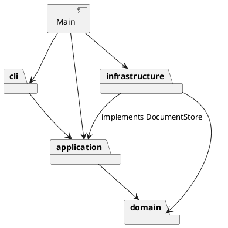

# 架构与开发记录

状态：Phase 1 交付验收版，自动化验证通过；浏览器渲染由使用者目视确认。

## 架构方案

### 模块划分

- `domain/`：画布、图形封装、容器树与唯一 id 约束。
- `application/`：编辑会话、Command 接口及命令、图形工厂。
- `cli/`：文本解析和命令分发。
- `infrastructure/`：SVG XML 编解码、变换归一化及本地文件系统适配。
- `Main.ts`：组合根，连接终端输入输出、会话、分发器与存储实现。



第一步领域对象暂时提供文本摘要供查询显示，未来若增加 GUI，应把展示格式移到独立展示适配器。

### 设计模式的选择

- Command：EditCommand 在隔离副本上执行编辑，成功后记录前后文档快照；Editor 管理 undo/redo 栈。CreateCommand 和 EditingCommands 构造每次独立的编辑命令。
- Composite：Shape 定义 move/scale/set/clone，五种叶子图形封装自身几何字段，Group 递归委托子节点。
- 名字分派仅允许在命令分发和图形工厂两处，按要求标注为待重构点。

### 依赖方向规则

- `cli → application → domain`：文本命令通过用例修改模型。
- `infrastructure → application/domain`：实现 application 的 DocumentStore 接口，构造/序列化领域对象。
- domain 不依赖上层、Node IO 或 XML 库；application 不引用 infrastructure，文件命令只依赖存储接口。
- `Main.ts` 是组合根，允许依赖上述各层，负责注入存储实现；cli 不依赖具体文件系统。
- 领域模型当前仍承担 tree/show 文本摘要，属于已知展示耦合；新增 GUI 时抽出展示适配器。

**依赖方向的理由**：领域层集中保存图形规则，不应因终端、文件系统或 XML 库变化而修改；应用层通过 `DocumentStore` 表达读写需求，具体适配器实现该接口，因此更换存储方式不需要让应用层引用新的实现。CLI 只负责解析与调度，未来增加其他输入通道时可以复用应用层。`Main.ts` 是组合根，集中创建和连接具体对象，是有意允许依赖各层的例外。

### 变化点假设

- 图形类型：Shape 的多态操作和 ShapeFactory 集中类型构造；插件注册暂不实现，保留工厂这一待重构点。新增一种叶子类无需改写编辑命令。
- 输入通道：Editor 与 CLI 分离，未来 GUI/agent 可复用用例；当前未提前建立消息总线。
- 持久化：DocumentStore 接口隔离文件系统，SvgCodec 单独处理 SVG；增加远程存储只需新适配器。
- 命令集合：CommandDispatcher 集中注册，EditCommand 统一处理事务和历史；插件阶段改为注册 API。
- 文档规模：当前快照简单可靠，若大文档带来性能问题再改为增量撤销；当前不实现复杂差异存储。
- SVG 覆盖面：明确支持六种图形和有限变换，不实现完整 SVG/CSS 引擎；未知内容拒绝读取，避免有损覆盖。

## 过程记录

以下依据本次对话与实际代码、测试整理。用户提出目标并选择验收方式；Codex 负责需求梳理、代码实现、检查和文档整理。除对话中明确发生的讨论外，不将 AI 的检查写成用户亲自发现的问题。

### 1. 明确当前阶段与协作方式

- 用户先要求查看课程页面、下载材料并建立仓库，随后提出分步开发，并明确“除需要 GUI 点击测试的部分由我来做，其他测试你自己做”。Codex 据此自行运行类型检查、命令回放和自动化测试，把 SVG 浏览器目视验收留给用户。
- 用户对是否应当做可视化编辑器提出疑问。重新对照附件后，确认标题与命令表要求的是 Phase 1 CLI：用 `svg>` 输入命令，保存 SVG 后可在浏览器预览；`box` 插件属于后续阶段，不作为本阶段实现目标。
- 先搭建图形模型和基本 CLI，再加入编辑与撤销重做，最后加入 SVG 文件读写。这样可以分别验证各阶段；开发中讨论了 Command 对编辑器操作历史的作用及快照方案的成本。

### 2. 原子性和撤销方案的取舍

- **问题**：一条组合命令可能修改多个子图形，如果执行到一半失败，画布不能停留在部分修改状态；一条编辑命令也必须对应一个撤销单元。
- **处理**：Codex 将 `EditCommand` 设计为先克隆画布，在副本上执行编辑，仅成功后替换当前画布并写入历史。undo/redo 在前后快照间切换。方案的代价是每次编辑要复制画布，文档较大时会增加时间与内存开销；本阶段没有提前实现复杂的增量差异记录。
- **验证**：`test/editor.test.ts` 包含容器缩放过程中数值溢出、非法参数、重复 ID 和循环归属等失败情况，检查失败前后的树结构及 redo 历史；`test/assignment.test.ts` 按附件典型会话验证编辑、撤销和重做。

### 3. 发现并修复容器样式继承问题

- **发现**：交付前由 Codex 对照实现复核时发现，图形从一个有 `fill` 或 `stroke` 的父容器移出，或解散有样式的容器后，SVG 的继承关系会改变，外观可能随之改变。该问题没有被最初的结构树测试充分覆盖。
- **纠正**：在 `Drawing` 的分组、转移和解组路径中比较移动前后的继承样式，仅在需要时为被移动的图形补上原先的有效属性；公共样式在 `Shape` 中封装。
- **验证**：新增 `test/editor.test.ts` 中的父容器样式迁移与撤销测试，以及 `test/svg.test.ts` 中的保存、重新读取和根元素 `px` 描边宽度测试。容器 `opacity` 属于整体合成，不是普通继承属性；跨该类容器移动或解组时外观仍可能变化，这是保留的限制。

### 4. 外部 SVG 和文件保存

- **问题与决策**：外部 SVG 元素可能缺 ID，而且后面的元素可能已经占用自动生成的名字。导入时先收集全部显式 ID，再按标签名与序号为缺失项补 ID 并打印警告。背景示例含 `translate` 和等比 `scale`，读入时归一化支持的变换；未知图形、属性或不支持的变换明确报错。
- **验证与修正**：通过附件中的 `other.svg`、ID 冲突、嵌套变换、XML 转义以及读写失败测试检查结果；写入先序列化并使用同目录临时文件，确认写入成功后再替换目标，失败时保留当前画布、历史和原文件。

### 5. 提交历史的整理

- 最初按需求、基础 CLI、编辑与历史、SVG 读写、问题修复分阶段提交。用户随后要求提交更细粒度，Codex 将已有变更按模型、CLI、测试和文档等重新拆分，并在用户明确要求后将该历史用于 `main` 和 `final`。
- **说明**：细粒度提交是对已有提交的事后重组，便于按变更内容审阅；它们不是当时逐条发生的开发记录。实际协作与迭代以本节及本次讨论为准，不把重组后的提交数量当作开发过程证据。

## 一致性自查

### 模块划分

实际目录与上面的修订后方案一致：`src/domain`、`src/application`、`src/cli`、`src/infrastructure` 及入口 `src/Main.ts` 分别对应图形规则、应用命令、文本交互、SVG/本地文件适配和对象组装；`test/` 存放测试，`examples/` 存放回放脚本和示例 SVG。

初期方案只有 CLI、应用和领域三层；加入 SVG 读写时新增 `infrastructure` 并将入口调整为组合根，已经反映在当前模块说明和依赖图中。当前仍存在职责偏集中的地方：`Drawing` 同时维护树、ID 索引和继承样式处理；`Shape` 也输出 `tree/show` 的文本摘要。它们未违反上述层间导入规则，但对高内聚和未来 GUI 扩展是不足，后续可分别抽出样式处理和展示适配器。

### 依赖方向

抽样检查了 `src` 下的 import：`domain` 未导入应用层、CLI、文件系统或 XML 库；`application` 未导入 `infrastructure`；`cli` 未直接依赖具体存储实现；`Main.ts` 作为组合根注入 `LocalDocumentStore`。因此，在上述约定的**层间导入规则**范围内未发现违反项。

这不是对所有内部耦合的证明：具体编辑操作集中在 `EditingCommands`，图形工厂集中持有内置类型，`Drawing` 也依赖具体 `Group`；新增命令、图形类型或更复杂的组合规则时仍可能需要修改这些类。命令名和图形类型名的两处集中分派已在架构方案中标为后续重构点。

## 质量保证手段

### 实际执行和结果

在 Node.js 24 环境执行：

```sh
npm ci
npm run check
npm test
```

已在干净导出的项目中安装依赖并执行检查；`npm run check` 通过，`npm test` 的 **25 项测试通过**。测试与证据如下：

| 检查对象 | 实际方法和位置 |
|---|---|
| 六种图形、属性及容器 | `test/editor.test.ts`：创建、属性白名单、递归移动/缩放、样式与层级 |
| 命令与历史 | 同文件检查分组、解组、排序、删除恢复、undo/redo 分支及文档操作后的屏障 |
| 失败原子性 | 检查非法参数、重复 ID、循环归属和组合操作中途数值溢出后，画布与历史未被部分修改 |
| SVG 输入输出 | `test/svg.test.ts`：缺失 ID 补全、重复 ID、转义、嵌套变换、往返、无效 XML、读取和写入失败 |
| 课程示例 | `test/assignment.test.ts` 回放附件典型编辑会话；`test/cli.test.ts` 验证命令行子进程 |
| 示例文件 | `npm run cli < examples/flowchart.commands` 生成流程图、检查保存后的撤销屏障，并读取 `examples/other.svg` |

在复核阶段，类型检查和 25 项自动化测试通过。它们覆盖上述场景，不代表所有 SVG 标准特性或所有输入都经过验证。当前只支持文档说明的 SVG 子集，对路径、CSS style、旋转、非等比缩放和嵌套文字等内容会拒绝读取；具体边界见项目根 `README.md`。

`examples/flowchart.svg` 可供用户在浏览器目视检查节点、文字及连线；截至文档整理时，用户尚未在对话中确认完成该项验收。浏览器目视检查不由自动化测试结果替代。

### 作业要求对应检查

| 要求 | 实现和证据 |
|---|---|
| TypeScript、类封装与多态、一类一文件 | `src/domain` 的 Shape 派生类、Group 及各层类；`npm run check` |
| Command 与 Composite | `EditCommand` / `Editor` 的事务和历史；`Shape` / `Group` 的统一图形接口和递归操作 |
| 六种图形及命令 | `CommandDispatcher` 命令注册，`ShapeFactory` 构造；`test/editor.test.ts` 和 `test/assignment.test.ts` |
| 唯一 ID、缺失 ID 警告、失败不改状态 | `Drawing`、`SvgCodec` 及 `test/svg.test.ts`；包含稍后出现的 ID 冲突和失败后的 redo |
| SVG 读写和历史屏障 | `LocalDocumentStore`、`FileCommands`；保存原子性、重读和屏障测试 |
| 架构、变化点、过程、依赖一致性、质量手段 | 本文各节和每阶段记录；`test/` 与 `examples/` |
| Git 及 final 标签 | 仓库的分阶段变更已推送，细粒度历史的事后重组见过程记录；`final` 指向提交版本 |
| 浏览器渲染确认 | `examples/flowchart.svg` 可供用户目视验收，自动化测试不代替目视验收 |
